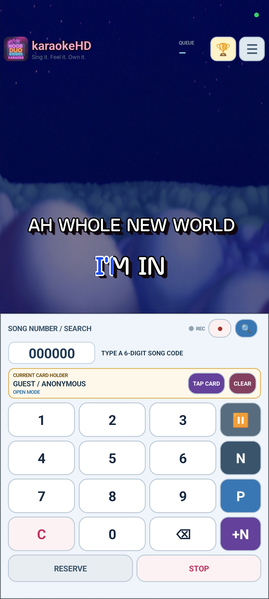

# KaraokeHD



**KaraokeHD is an experimental offline AI-powered Android karaoke platform built with .NET MAUI.**

It combines a dedicated **KaraokeHD Player** with a separate and powerful **KaraokeHD Remote companion app**.

KaraokeHD supports traditional **MIDI/KAR karaoke** and modern **MP3-LRC karaoke**. Its built-in offline AI tools can separate an MP3 into vocal and instrumental tracks, then generate synchronized **Enhanced LRC lyrics** with progressive word-level highlighting.

The platform also provides Multi-SF2 playback, dual synthesizer engines, real-time 16-channel instrument manipulation, automatic device-based microphone calibration, near-zero-latency microphone monitoring on supported hardware, singing scores, performance recording, song-specific video backgrounds, MusicXML score display, remote media management, and protected MIDI/KAR lyric repair.

The project grew from years of experimentation with karaoke systems across VB6, PSP/TiMidity, Java phones, Symbian, Python terminal playback, portable HTML players, PHP-based karaoke servers, and modern Android development.

> KaraokeHD is developed as a laboratory project.  
> Functionality, playback reliability, and architectural validation come before cosmetic enhancement.

## Download KaraokeHD

### [Download KaraokeHD Player, Remote, test releases, and project files from Google Drive](https://drive.google.com/drive/folders/1uzKgq8kEgkySe327vFV9i20q6Q9_ZzFi?usp=sharing)

> The download folder may contain experimental and device-testing builds. Preserve your current validated APK and source package before testing a newer gate.

---

## Why Is the APK More Than 300 MB?

KaraokeHD is not an ordinary karaoke player.

The Player APK is more than 300 MB mainly because it includes two offline AI models:

- An offline vocal and instrumental splitter for MP3 songs
- An offline AI lyrics creator for generating Enhanced LRC lyrics

These tools allow an MP3 legally owned by the user to be processed into an instant karaoke song.

The normal AI workflow is:

1. Select an MP3 song.
2. Separate the original recording into vocal and instrumental tracks.
3. Analyze the isolated vocal track.
4. Generate synchronized Enhanced LRC lyrics.
5. Review or quickly edit the generated lyrics when necessary.
6. Play the instrumental track with progressive karaoke highlighting.

AI processing is performed locally on the Android device. Songs do not need to be uploaded to an online transcription or stem-separation service.

Processing speed depends on the device, song duration, thermal condition, and available storage.

---

## Screenshots


Additional screenshots are stored in:

```text
docs/
`-- images/
    |-- karaokehd-hero.png
    |-- karaokehd-features.png
    |-- karaokehd-player.png
    |-- karaokehd-remote.png
    |-- karaokehd-mp3-lrc.png
    |-- karaokehd-ai-tools.png
    |-- karaokehd-multisf2.png
    |-- karaokehd-recorder.png
    |-- karaokehd-background-manager.png
    |-- karaokehd-kar-editor.png
    `-- karaokehd-musicxml.png
```

---

## Download

Prebuilt KaraokeHD Player and Remote packages, test releases, and related project files are available from the official project folder:

### [Download KaraokeHD from Google Drive](https://drive.google.com/drive/folders/1uzKgq8kEgkySe327vFV9i20q6Q9_ZzFi?usp=sharing)

> Packages in the download folder may include experimental and device-testing builds. Preserve your current validated APK and source package before installing or testing a newer gate.

### Important Download Notice

KaraokeHD packages do **not** include:

- Third-party SoundFont `.sf2` audio libraries
- Commercial MIDI or KAR song collections
- Copyrighted karaoke lyrics
- Licensed background music
- Copyrighted photographs or videos
- Third-party media collections

Users must provide their own legally obtained SoundFont and media files.

The large APK size is caused primarily by KaraokeHD's included offline AI processing models, not by bundled commercial songs, SoundFonts, lyrics, photographs, or background videos.

---

## Main Components

### KaraokeHD Player


The Player is the main Android karaoke engine.

It handles:

- MIDI and KAR playback
- MP3 playback with standard or Enhanced LRC lyrics
- Offline vocal and instrumental separation
- Offline AI-assisted Enhanced LRC creation
- Multi-SF2 audio rendering
- Dual synthesizer engines
- Synchronized progressive karaoke lyrics
- Local song catalog management
- Queue and Auto Queue control
- Real-time 16-channel MIDI manipulation
- Automatic device-based microphone calibration
- Low-latency microphone monitoring
- Singing-score capture and calculation
- Music-only and music-plus-vocal recording
- Background images and decorative video
- Song-specific background video assignment
- Camera and photo backgrounds
- Remote commands from the companion app
- Protected MIDI/KAR upload and replacement
- Idle song-list presentation

### KaraokeHD Remote


The separate Remote companion app is not limited to basic playback control. Many of KaraokeHD's advanced companion functions are available through the Remote APK.

It provides:

- Automatic Player discovery
- Manual Player address configuration
- Local catalog synchronization
- Fast SQLite-backed song search
- Numeric song selection
- Remote play, pause, stop, seek, and queue control
- Queue clearing and Auto Queue control
- MIDI channel monitoring and control
- Lyric-color selection
- Background dimmer control
- Photo upload and management
- Front- and rear-camera background sources
- MIDI/KAR uploading
- Integrated MIDI/KAR Lyrics Editor
- MusicXML opening, rendering, playback, and score display
- Wireless microphone operation
- Advanced MIDI, audio, display, and Player controls

---

## MIDI and KAR Karaoke

KaraokeHD renders MIDI and KAR files directly on Android using user-supplied SF2 SoundFonts.

Playback capabilities include:

- Local MIDI and KAR loading
- Minimized and background playback
- Accurate playback-position tracking
- Pause, resume, stop, and seek
- Automatic transition to the next queued song
- Persistent foreground playback notification
- Android audio output
- Configurable local SF2 selection
- Multiple SF2 catalogs
- Per-song instrument overrides
- Real-time 16-channel manipulation

---

## MP3-LRC Karaoke

KaraokeHD supports MP3 karaoke with:

- Standard line-timed LRC lyrics
- Enhanced LRC lyrics
- Progressive word-level synchronization
- Instrumental tracks created by the offline splitter
- Existing downloaded LRC lyrics
- AI-generated Enhanced LRC lyrics
- User-reviewed or manually corrected lyrics

An available LRC may be downloaded and used directly. If the downloaded or existing LRC is missing, incorrectly timed, too coarse, or contains incorrect words, the AI lyrics workflow can create a replacement Enhanced LRC from the isolated vocal track.


---

## Offline AI Karaoke Creation

KaraokeHD can process an MP3 legally owned or authorized for use by the user and prepare it for karaoke playback.

### Offline Vocal and Instrumental Splitter

The splitter creates separate working tracks for:

- Instrumental or accompaniment audio
- Isolated vocal audio

The instrumental track may be used for karaoke playback. The isolated vocal track provides a cleaner source for AI lyrics analysis.

### Enhanced LRC Creator

The AI lyrics creator uses the available vocal track to generate synchronized Enhanced LRC.

Enhanced LRC provides more detailed synchronization than ordinary line-level LRC and allows progressive word-level highlighting during playback.

Generated or downloaded lyrics may still require review because transcription accuracy can be affected by:

- Pronunciation
- Vocal effects
- Multiple singers
- Background vocals
- Language mixing
- Unusual phrasing
- Noisy source material
- Overlapping instruments
- Incorrect source audio

KaraokeHD provides editing assistance for correcting generated or downloaded lyrics.


---

## Synchronized Karaoke Lyrics

The Player reads lyric and text events embedded in MIDI and KAR files and supports external lyrics for MP3 playback.

Supported presentation behavior includes:

- Uppercase lyric display
- Progressive highlighting
- Word-level Enhanced LRC highlighting
- Line and screen-break markers
- Instrumental and interlude banners
- Countdown before the first lyric
- Configurable lyric fill colors
- Remote lyric-color control
- Guide-channel detection and mute support
- Continuous MP3-LRC playback timing
- Compact portrait and landscape layouts

---

## Multi-SF2 Instrument Catalog

KaraokeHD is not limited to a single SoundFont.

Multiple `.sf2` files may be loaded, inspected, and managed as one searchable instrument catalog.

KaraokeHD can automatically search across the available SF2 catalog and select an appropriate:

- SoundFont
- Bank
- Program
- Instrument

A single MIDI or KAR song may use instruments from several different SF2 files.

For example:

- Piano may come from one SF2.
- Guitar may come from another SF2.
- Bass may use a third SF2.
- Channel 10 drums may use a dedicated drum-oriented SoundFont.

Only SF2 files placed inside the designated KaraokeHD `sf2` folder are available for cataloging and selection.

---

## Real-Time 16-Channel Mixer

KaraokeHD provides control over all 16 standard MIDI channels.

Each active channel can display:

- Channel number
- Detected instrument
- Active SF2
- Bank and program
- Manual instrument assignment
- Guide-channel confidence
- Mute state
- Solo state
- Percussion state

Mixer functions include:

- Persistent channel mute
- Channel solo
- Manual melodic instrument assignment
- Per-song instrument overrides
- Real-time instrument reassignment
- Moving a channel between available SF2 files
- Bank and program selection
- Karaoke guide-channel control
- Master equalization
- Remote channel-state reporting

Manual instrument assignments may remain authoritative instead of being immediately replaced by later automatic program events.


---

## Dual Synthesizer Engines

KaraokeHD provides two MIDI synthesizer engines.

### MeltySynth

MeltySynth is the carefully controlled KaraokeHD playback engine.

KaraokeHD applies special handling for guitar performance, including expressive pitch bends and instrument behavior intended to make MIDI guitar parts sound more natural and less like basic General MIDI playback.

MeltySynth is suitable when the user wants:

- Predictable KaraokeHD behavior
- Controlled instrument selection
- Carefully handled guitar performance
- Manual channel authority
- Direct mixer integration

### FluidSynth

FluidSynth is the convenient alternative for users who prefer an easier route to rich SoundFont playback with less manual adjustment.

It is suitable when the user wants:

- Broad SoundFont compatibility
- Fast instrument setup
- Multi-SF2 operation
- Fuller playback with less manual adjustment
- An alternative synthesis character

Users may select the engine that best fits the song, SoundFont collection, and preferred playback style.

---

## Dynamic SF2 Drum Kit Inventory

Manual Channel 10 selection is not limited to a hard-coded drum-kit list.

KaraokeHD inspects available SoundFonts and lists percussion presets found in SF2 bank 128.

Depending on the loaded SoundFonts, the available list may include:

- Standard Drum Kit
- Room Drum Kit
- Power Drum Kit
- Electronic Drum Kit
- TR-808 Drum Kit
- Jazz Drum Kit
- Brush Drum Kit
- Orchestra Drum Kit
- SFX Drum Kit
- Custom SoundFont drum kits

Each detected kit is displayed using its available preset name and program number.

### Automatic Drum Selection

For simple operation, KaraokeHD may use an automatic fallback order such as:

1. Power Drum Kit
2. Jazz Drum Kit
3. Standard Drum Kit

Manual mode exposes the detected drum-kit inventory of the available SoundFont catalog.

### General MIDI Compatibility

KaraokeHD follows the established General MIDI convention that uses Channel 10 for percussion.

The underlying MIDI protocol can technically route other musical data through any channel, but the General MIDI convention provides more predictable percussion playback across compatible MIDI files, synthesizers, and SoundFonts.

---

## Microphone and Automatic Calibration

KaraokeHD includes local microphone monitoring and automatic device-based calibration.

The calibration process evaluates the active device and audio route so KaraokeHD can compensate for device-specific microphone and output timing.

On supported low-latency devices, this allows microphone monitoring with almost zero perceived delay.

Actual latency may still be affected by:

- Android device audio implementation
- Wired or wireless microphone type
- USB audio interface
- Bluetooth codec and buffering
- Selected input and output route
- Device processing load

A wired microphone, wired headset, or compatible low-latency USB audio interface normally provides the best monitoring result. Bluetooth audio may introduce additional delay outside KaraokeHD's direct control.

The microphone may be used for:

- Live vocal monitoring
- Singing-score input
- Music-plus-vocal performance recording
- Wireless microphone input from the Remote app

---

## Singing Score

KaraokeHD can analyze a singer's microphone performance.

The scoring architecture uses the MIDI song as the musical reference and records a lightweight timestamped microphone performance trace during playback.

The trace may contain:

- Detected note
- Frequency
- Confidence
- Input level
- Timing
- Silence or no-input periods

Final comparison and score calculation are performed after the song rather than continuously during playback. This reduces unnecessary real-time processing during the performance.

Scoring can consider:

- Pitch matching
- Octave-equivalent notes
- Chord matches
- Timing
- Partial matches
- Sustained-note matches
- Detection confidence
- Silence and missing-input periods

---

## Performance Recorder

KaraokeHD includes a built-in recorder for saving karaoke performances.

The recorder can capture:

- Music or instrumental audio only
- Music or instrumental audio together with microphone vocal

When microphone functions are disabled, KaraokeHD can create a music-only recording without a microphone stem.

When microphone monitoring or scoring capture is active, KaraokeHD can create a complete music-and-vocal performance.

Processed music and vocal streams may be maintained separately before final mixing. This allows KaraokeHD to produce a cleaner final recording than directly capturing uncontrolled speaker output.


---

## Background Video Manager

KaraokeHD includes a Background Video Manager for organizing and controlling the videos shown on the karaoke stage.

Background videos may operate in two primary modes:

### General

General videos are available as rotating backgrounds and may play during any song without a specific assignment.

### Assigned Only

A background video can be assigned to one song or to a selected group of songs.

An assigned-only video plays only when one of its linked songs is active.

The manager supports many-to-many assignments:

- One video may be assigned to several songs.
- One song may have several assigned videos.
- Unassigned songs may continue using the general background collection.
- A song-specific assignment may take priority over general background rotation.

This allows users to prepare matching videos for particular songs, performers, genres, events, or presentations without affecting the rest of the karaoke library.

Background videos must be stored inside the designated `background` folder and scanned before they become available.


---

## Integrated MIDI/KAR Lyrics Editor

The Remote includes an integrated workspace for repairing MIDI and KAR lyrics without manually transferring working files between devices.

The editor is inspired by the practical lyric-editing workflow of Karakan.

The normal workflow is:

1. Search for a song in the Remote catalog.
2. Open the song in the KAR Editor.
3. Download the authoritative MIDI or KAR file from the Player.
4. Preserve its song code, filename, and Player information.
5. Edit lyric text and karaoke markers.
6. Adjust individual lyric-event timing.
7. Preview the edited file locally.
8. Save and reparse the repaired file.
9. Perform round-trip validation.
10. Upload the validated replacement to the Player.

Editor capabilities include:

- MIDI/KAR lyric extraction
- Token-based lyric workspace
- Text repair
- Line-break and screen-break markers
- Per-token timing offsets
- Local SF2 playback preview
- Seek and resume-from-token controls
- Current and next lyric preview
- Persistent editing workspaces
- Delayed upload support
- Round-trip validation
- Protected Player replacement


---

## Protected MIDI/KAR Replacement

KaraokeHD does not directly overwrite a Player song without validation.

The replacement process verifies:

- Six-digit catalog code
- Expected filename
- Original catalog association
- Uploaded MIDI/KAR structure
- Staged-file readability
- Final committed-file integrity

The Player creates a backup before replacement and retains rollback protection if validation or file commitment fails.

Editing or replacing a file through KaraokeHD does not alter the copyright ownership or licensing requirements of that file.

---

## MusicXML and Real Music-Sheet Display

The Remote companion can open and render MusicXML as an actual musical score.

MusicXML capabilities include:

- Standalone MusicXML opening
- Score rendering
- Part selection
- MusicXML playback
- SF2-based playback
- Percussion support
- Seek control
- Playback-speed control
- Active-measure highlighting
- Automatic score following

This allows the Remote to operate as more than a karaoke controller. It can also act as a portable music-score viewer and playback tool.


---

## Wireless Microphone

The Remote companion may also operate as a wireless microphone input for the Player.

This extends the companion app beyond ordinary remote commands and allows the Android Remote device to participate directly in a karaoke session.

Wireless audio performance depends on:

- Network quality
- Device processing capability
- Wireless interference
- Audio routing
- Input and output buffering

For the lowest possible live-monitoring latency, a local wired or low-latency audio input remains preferable.

---

## Song Catalog

KaraokeHD uses a local SQLite catalog for fast song searching and remote operation.

Catalog behavior includes:

- Six-digit song codes
- Filename-derived title and artist display
- Cursor-paged searching
- Manual catalog synchronization
- New-song synchronization
- Full subfolder rebuild
- Catalog export
- Validated catalog import
- Immediate catalog update after supported uploads

The normal organization workflow is:

1. Analyze
2. Sync New
3. Stop and organize when required
4. Restart the Player

---

## Initial Installation

### 1. Select the Main Storage Location

On first setup, select the storage location that KaraokeHD will use.

KaraokeHD automatically creates its working structure inside that location:

```text
KaraokeHD/
`-- karaoke/
    |-- sf2/
    |-- background/
    `-- karaoke/
```

Folder purposes:

```text
sf2/
    Stores the SoundFont files used for MIDI and KAR playback.
    Multiple SF2 files may be placed in this folder.

background/
    Stores background videos used by the video stage and
    Background Video Manager.

karaoke/
    Stores the MIDI and KAR song library.
```

### 2. Add at Least One MIDI or KAR File

Put MIDI or KAR files inside the inner `karaoke` folder.

Users may:

- Create folders named `midi_a` through `midi_zzz` and place MIDI or KAR files inside them.
- Put bulk ZIP packages containing MIDI or KAR songs inside one of those folders.

During initial setup, KaraokeHD builds its working structure and creates:

```text
karaokeHD.db
```

At least one valid MIDI or KAR file must be available during initialization.

If no MIDI or KAR file is detected, setup will display an error and the song index cannot be completed.

To continue:

1. Add at least one MIDI or KAR file.
2. Restart KaraokeHD.
3. Run the initial setup again.

Only one valid MIDI or KAR file is required to initiate the system.

### 3. Allow Initial Restarts

KaraokeHD may restart several times while creating directories, checking storage access, building `karaokeHD.db`, and initializing its components.

This is normal during the first installation.

### 4. Add and Select SoundFonts

Copy the required `.sf2` files into:

```text
KaraokeHD/karaoke/sf2/
```

Then open:

```text
System > Technical Info > Select SF2
```

Only SoundFont files stored inside the designated `sf2` folder are available to KaraokeHD.

Select and verify the available SF2 files. KaraokeHD catalogs their banks, programs, and instruments for use by the Multi-SF2 system.

The system may restart again after SF2 verification and loading.

### 5. Add and Scan Background Videos

Put background videos inside:

```text
KaraokeHD/karaoke/background/
```

During the first boot, the video stage may remain black because the background library has not yet been initialized.

Open:

```text
System > Video > Scan
```

After the scan, detected videos become available to the video stage and Background Video Manager.

They may then be used as general rotating backgrounds or assigned to specific songs or groups of songs.

> Initial database creation, SF2 verification, background scanning, and repeated restarts are normally required only during the first installation.

---

## Building the Project

### Requirements

- Windows
- .NET SDK with the Android workload
- Android SDK
- Android ARM64 device or compatible test environment
- User-supplied and legally obtained SF2 SoundFont files
- Adequate storage for AI models, temporary stems, recordings, and media

The preferred APK build process:

1. Clear `bin` and `obj`.
2. Force package restoration.
3. Publish for `net10.0-android`.
4. Target `android-arm64`.
5. Use Debug APK output for laboratory device testing when appropriate.
6. Disable fast deployment.
7. Embed required managed assemblies.
8. Locate the newest generated APK.
9. Copy the APK beside the build script using a clear release-specific filename.

---

## SoundFont Requirement

KaraokeHD requires one or more compatible `.sf2` SoundFonts for MIDI and KAR audio rendering.

**No third-party SoundFont audio files are included, hosted, mirrored, or distributed with KaraokeHD.**

SoundFont files may contain:

- Recorded instrument samples
- Synthesized audio material
- Preset definitions
- Proprietary instrument libraries
- Other copyrighted or licensed content

To avoid unauthorized redistribution, KaraokeHD does not provide third-party SoundFont files.

Users must:

1. Obtain SF2 SoundFonts from legitimate sources.
2. Review and follow each SoundFont's license.
3. Confirm that they are permitted to use the files on their device.
4. Avoid redistribution unless the license explicitly permits it.
5. Place the SoundFonts inside KaraokeHD's designated `sf2` folder.
6. Verify and select them through the Player's SF2 workflow.

KaraokeHD supports standard SF2 files containing uncompressed 16-bit PCM samples.

SF3 and other compressed SoundFont formats are not currently supported unless explicitly added and validated by a later development gate.

---

## Release and Gate Information

KaraokeHD evolves through protected, device-tested development gates.

Because experimental Player and Remote builds may advance independently, the most recent APK is not automatically considered the most stable release.

For each published gate, record:

- Gate name
- Display version
- Android build number
- Target architecture
- Source package name
- Source SHA-256
- APK name
- APK SHA-256
- Device-test status
- Preserved behavior
- Known limitations

Detailed gate information should be placed in:

- GitHub Releases
- A dedicated `CHANGELOG.md`
- The official Google Drive release folder
- Release-specific notes supplied with each package

This keeps the main README accurate without locking it to an older development checkpoint.

---

## Project Philosophy

KaraokeHD follows several practical development principles:

- Functionality before decoration
- Device testing before feature expansion
- Proof-of-concept validation before architectural escalation
- Protected stable rollback gates
- Local-first operation
- Dedicated remote control
- Controlled file replacement
- Preservation of existing working behavior
- New features should solve observed usage problems
- Each architectural layer should be validated before the next layer is introduced

The project intentionally remains experimental and evolves through gated, device-tested builds.

---

## Project History

KaraokeHD is the latest stage of a long-running personal karaoke experiment.

Earlier implementations and experiments included:

- VB6 karaoke development beginning around 2004
- PSP and TiMidity experiments
- Java phone playback
- Symbian implementations
- Python terminal karaoke under Termux
- Portable monolithic HTML karaoke
- PHP server-based karaoke
- Browser-based audio engines and lyric parsers
- Modern Android Player and Remote applications

Some earlier HTML and PHP experiments were published under aliases and project identities associated with:

- `sempogi`
- `noobdou`
- `codex45`
- `doggy`
- `axlrose`
- `spartacute`
- `spartacus`
- `kentoterror`

These names belong to the same long-running body of experimental work.

---

## Media and Copyright Disclaimer

KaraokeHD is a software player, controller, editor, offline processing tool, and interoperability-testing project.

It does not grant users ownership of, or redistribution rights to, any third-party media opened, played, separated, transcribed, edited, uploaded, downloaded, replaced, recorded, or managed through the application.

The project does not provide or distribute:

- Third-party SoundFont or SF2 audio libraries
- MIDI or KAR song collections
- Copyrighted karaoke lyrics
- Commercial karaoke tracks
- Background music
- Copyrighted photographs or videos
- Third-party media packages

Users are solely responsible for ensuring that their MP3, MIDI, KAR, SF2, LRC, MusicXML, image, video, and other media files are legally obtained and used according to applicable licenses, permissions, and local laws.

Separating an MP3 into vocal and instrumental tracks does not change:

- Ownership of the original recording
- Copyright status
- Licensing requirements
- Public-performance restrictions
- Redistribution restrictions
- Attribution requirements

Generating or editing Enhanced LRC does not grant rights to redistribute copyrighted lyrics.

Editing, repairing, converting, downloading, uploading, or replacing a file through KaraokeHD does not change:

- Ownership of the file
- Copyright status of the file
- Licensing requirements
- Redistribution restrictions
- Attribution requirements

Project contributors are not responsible for media supplied, processed, uploaded, modified, shared, performed, recorded, or redistributed by individual users.

---

## Software Disclaimer

KaraokeHD is an experimental laboratory project provided for:

- Software development
- Interoperability testing
- Personal experimentation
- MIDI and KAR research
- Offline audio-processing research
- Legitimate personal karaoke use

The software is provided **as is**, without warranties or guarantees regarding:

- Compatibility with every Android device
- Compatibility with every MP3, MIDI, KAR, LRC, MusicXML, or SF2 file
- AI separation or transcription accuracy
- Playback accuracy with every SoundFont
- Microphone latency on every Android device
- Singing-score accuracy
- Availability of every experimental feature
- Preservation of user-supplied files
- Suitability for commercial or production use
- Continued compatibility between experimental gates

Users should preserve backups of:

- Their current validated APK
- Source packages
- SQLite song catalogs
- MIDI and KAR files
- MP3 and LRC files
- AI-generated stems
- Recordings
- Editing workspaces
- Configuration files
- Channel and mixer settings
- Any media managed by the application

New gates may contain experimental changes and should be tested before replacing a validated installation.

---

## Third-Party Components

KaraokeHD may use open-source libraries and Android platform components.

Each third-party component remains subject to its own:

- License
- Attribution requirements
- Usage conditions
- Modification terms
- Distribution terms

Compatibility with a file format, library, engine, SoundFont, AI model, or external tool does not imply ownership, endorsement, sponsorship, or authorization to redistribute third-party content created for that format or tool.

---

## Development Status

KaraokeHD is actively developed and tested as a laboratory platform.

Features may be:

- Experimental
- Device-specific
- Revised between gates
- Protected behind rollback versions
- Promoted only after successful device validation

Always preserve a currently validated gate before installing a newer experimental build.
